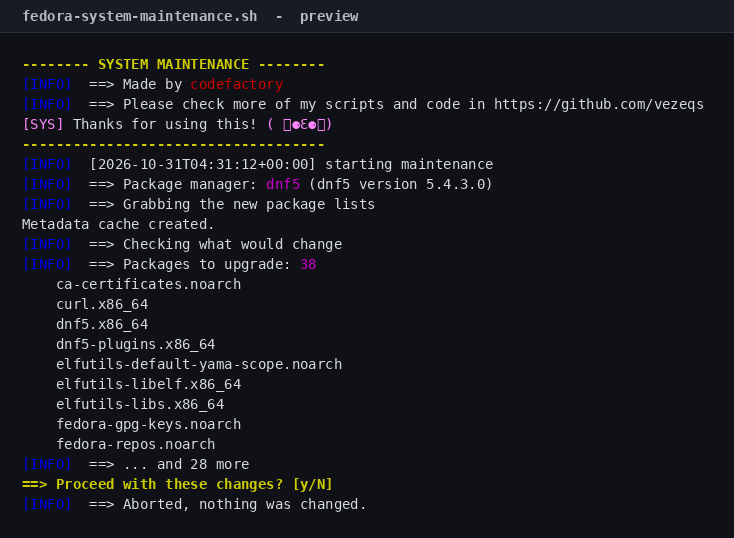
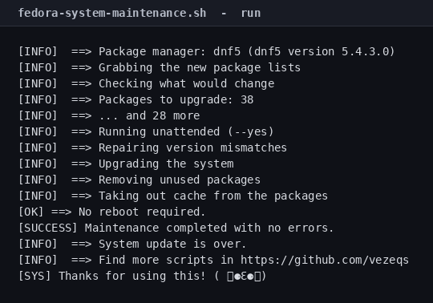

# Fedora System Maintenance Script

[](LICENSE)
[](#tested-on)

One command to update, clean and repair Fedora. It shows you what will change,
**asks before touching anything**, and tells you if a reboot is needed.



## Quick start

```bash
git clone https://github.com/vezeqs/fedora-system-maintenance.git
cd fedora-system-maintenance
sudo ./fedora-system-maintenance.sh
```

## What it does

| # | Step | Command |
|---|------|---------|
| 1 | Refresh the package metadata (3 attempts) | `dnf makecache` |
| 2 | Show what would change | `dnf check-upgrade`, `dnf repoquery --unneeded` |
| 3 | **Ask for confirmation** | `Proceed? [y/N]` |
| 4 | Repair version mismatches | `dnf distro-sync` |
| 5 | Upgrade everything | `dnf upgrade` |
| 6 | Remove unused packages | `dnf autoremove` |
| 7 | Clean the package cache | `dnf clean all` |
| 8 | Check for a pending reboot | `needs-restarting -r`, or a kernel comparison |

`dnf5` is used when it is installed, `dnf4` otherwise. The preview lists the
packages that would be upgraded and names the ones that would be removed.

## The confirmation prompt

Nothing is installed or removed until you answer `y`. Before asking, the script
prints how many packages would be upgraded, the first ten of them, and any
unused packages that would be removed:


Answer anything but `y` and it exits with `nothing was changed`.

## Options

| Flag | Effect |
|------|--------|
| `-y`, `--yes` | Skip the confirmation prompt (cron, unattended runs) |
| `-n`, `--dry-run` | Print every command without running it |
| `-h`, `--help` | Show usage |

Without `-y`, the script refuses to run if there is no terminal to confirm on,
so a cron job fails loudly instead of upgrading silently.

## Fedora Atomic

On Silverblue, Kinoite, Bazzite and Bluefin the base image is not managed by
dnf. When `/run/ostree-booted` exists, the script switches to:

```bash
rpm-ostree upgrade
rpm-ostree cleanup -p
flatpak update -y        # only when flatpak is installed
```

It then checks `rpm-ostree status` for a pending deployment and tells you
whether a reboot is needed.

## Example

A real run against a `fedora:44` container, 38 packages behind:



## Requirements

- Fedora 39 or newer, or a Fedora-based distribution
- root (`sudo`)
- Bash 4.0+ (default everywhere)

## Safety notes

- **`distro-sync` can downgrade packages** that are newer than the configured
  repositories. That is the point of the repair step, but it matters if you use
  third-party repos.
- **`autoremove` removes dependencies** that nothing depends on any more.
- **`clean all` deletes cached packages**, so a rollback needs a re-download.
- **`--dry-run` never changes anything**, including the preview queries.
- **Fails fast.** `set -euo pipefail` plus an `ERR` trap that reports the failing
  command and its exit status.

## Tested on

| Image | Result |
|-------|--------|
| `fedora:44`, dnf5 5.4.3.0 | 38 packages upgraded in a 79-package transaction, cache cleaned, no reboot required |

The container has no kernel package, so the reboot check reported "No reboot
required" through the fallback path. On a real system, `needs-restarting -r` is
used when `dnf-plugins-core` is installed.

## License

MIT — see [LICENSE](LICENSE).

## Author

**codefactory** — [github.com/vezeqs](https://github.com/vezeqs)
